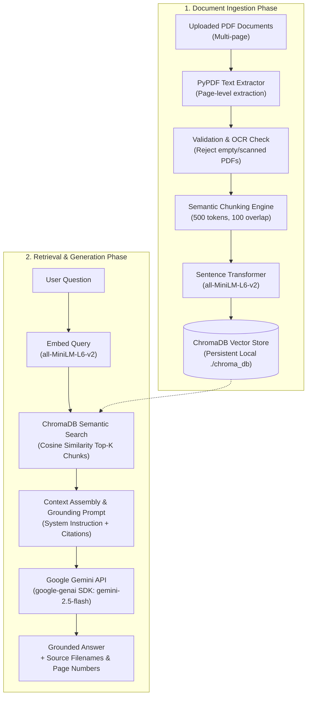

# 📚 RAG-Based Document Question Answering Chatbot

An enterprise-grade, privacy-first Retrieval-Augmented Generation (RAG) Document Question Answering system built with **Streamlit**, **Sentence Transformers**, **ChromaDB**, and **Google Gemini** using the official `google-genai` SDK.

---

## 📑 Table of Contents

1. [Project Overview](#1-project-overview)
2. [Problem Statement](#2-problem-statement)
3. [Objectives](#3-objectives)
4. [Technologies Used](#4-technologies-used)
5. [System Architecture](#5-system-architecture)
6. [RAG Pipeline Workflow](#6-rag-pipeline-workflow)
7. [Installation Instructions](#7-installation-instructions)
8. [Environment Setup](#8-environment-setup)
9. [How to Run the Application](#9-how-to-run-the-application)
10. [Document Ingestion Process](#10-document-ingestion-process)
11. [Text Chunking & Embedding Strategy](#11-text-chunking--embedding-strategy)
12. [ChromaDB Vector Retrieval](#12-chromadb-vector-retrieval)
13. [Google Gemini Integration](#13-google-gemini-integration)
14. [RAG vs Without RAG Comparison (Compulsory Demonstration)](#14-rag-vs-without-rag-comparison)
15. [Document Management & Explorer](#15-document-management--explorer)
16. [Screenshots Guide](#16-screenshots-guide)
17. [Limitations](#17-limitations)
18. [Future Enhancements](#18-future-enhancements)
19. [Conclusion](#19-conclusion)

---

## 1. Project Overview

Large Language Models (LLMs) possess vast general knowledge but cannot reliably answer questions about private, proprietary, or domain-specific documents. When queried about unseen documents, standard LLMs often **hallucinate** plausible yet incorrect facts.

This project implements an end-to-end **Retrieval-Augmented Generation (RAG)** pipeline that enables users to upload multi-page PDF documents and interrogate them naturally. The system extracts text, chunks it semantically, creates dense vector representations using Sentence Transformers (`all-MiniLM-L6-v2`), indexes them locally in **ChromaDB**, and passes relevant excerpts to **Google Gemini** (`gemini-2.5-flash`) with a strict grounding prompt.

---

## 2. Problem Statement

Standard generative AI systems suffer from three fundamental problems when applied to enterprise documents:
1. **Knowledge Cutoff & Inaccessibility**: LLMs cannot access private, local, or newly generated PDFs.
2. **Hallucination Risk**: When asked specific factual questions about unlearned material, LLMs generate convincing falsehoods.
3. **Lack of Auditability**: General LLM responses do not provide page numbers, source excerpts, or verifiable citations.

---

## 3. Objectives

- **Multi-Document Ingestion**: Seamlessly ingest multi-page real PDFs (10–20+ pages) with validation for scanned or empty documents.
- **Accurate Text Chunking**: Split documents into ~500-token chunks with ~100-token overlap, preserving paragraph boundaries and sentence integrity.
- **Local Persistent Vector Storage**: Use ChromaDB locally without expensive cloud dependencies or third-party paid subscriptions.
- **Semantic Similarity Search**: Match user queries to document passages using cosine similarity on dense embeddings.
- **Strict Grounded Generation**: Instruct Google Gemini to answer strictly using retrieved document context and report when information is absent.
- **Auditable Citations**: Display exact source filenames, page numbers, and similarity metrics for every answer.
- **Authentic Side-by-Side Comparison**: Provide a live comparison of Gemini answering **Without RAG** vs **With RAG** to prove grounding efficacy.

---

## 4. Technologies Used

| Layer | Technology | Version | Purpose |
| :--- | :--- | :--- | :--- |
| **Frontend UI** | Streamlit | `>=1.35.0` | Dark-themed, responsive dashboard interface |
| **Vector Database** | ChromaDB | `>=0.5.0` | Local persistent vector storage and cosine similarity search |
| **Embedding Model** | Sentence Transformers | `all-MiniLM-L6-v2` | 384-dimensional dense semantic text embeddings |
| **LLM Inference** | Google Gemini API | `google-genai` | Official Google GenAI SDK (`gemini-2.5-flash`) |
| **PDF Extraction** | PyPDF | `>=4.0.0` | Pure-Python PDF text extraction across multiple pages |
| **Tokenization** | Tiktoken | `>=0.7.0` | Accurate token counting and overlap slicing |
| **Configuration** | Python Dotenv | `>=1.0.0` | Environment variable management |

---

## 5. System Architecture



---

## 6. RAG Pipeline Workflow

1. **Document Loading**: PyPDF parses the uploaded PDF into individual page objects, extracting raw text and tracking page indices (1-based).
2. **Text Normalization & Validation**: Extracted text is checked for quality. If extracted text is fewer than 50 characters across all pages, the document is flagged as scanned/empty.
3. **Chunking**: Text is split into paragraphs and sentences, then packed into chunks of ~500 tokens with ~100 tokens of sliding overlap. Metadata (source filename, page number, chunk index, document hash) is attached.
4. **Vector Embedding**: Each chunk is embedded into a 384-dimensional dense vector using `all-MiniLM-L6-v2`.
5. **ChromaDB Indexing**: Embeddings, raw chunk text, and metadata are saved to `./chroma_db`.
6. **Query Embedding & Retrieval**: The user query is converted into a vector with the identical embedding model, and top-$k$ nearest neighbors are retrieved using cosine distance.
7. **Prompt Synthesis**: The retrieved chunks are assembled into an augmented prompt with strict instructions: do not assume, do not hallucinate, and cite page numbers.
8. **Generation**: Google Gemini synthesizes an accurate, factual answer referencing the provided context.

---

## 7. Installation Instructions

### Prerequisites
- macOS, Linux, or Windows (Tested on macOS Sonoma / Sequoia Apple Silicon & Intel)
- Python 3.10 to 3.12 (Python 3.12 recommended)
- Git

### 1. Clone or Open the Repository
```bash
cd /Users/mallimpallilohith/Documents/Intern/RAG-Document-Chatbot
```

### 2. Create and Activate a Python Virtual Environment
```bash
# Using Python 3.12
python3.12 -m venv venv

# Activate on macOS/Linux:
source venv/bin/activate

# Activate on Windows:
# .\venv\Scripts\activate
```

### 3. Install Dependencies
```bash
pip install --upgrade pip
pip install -r requirements.txt
```

---

## 8. Environment Setup

Copy `.env.example` to `.env`:
```bash
cp .env.example .env
```

Open `.env` and provide your Google Gemini API key:
```env
# Google Gemini API Key (Get from https://aistudio.google.com/app/apikey)
GEMINI_API_KEY=AIzaSy...your_real_key_here
GEMINI_MODEL=gemini-2.5-flash

# ChromaDB & Embedding Configuration
CHROMA_PERSIST_DIRECTORY=./chroma_db
EMBEDDING_MODEL_NAME=all-MiniLM-L6-v2

# Chunking Configuration
DEFAULT_CHUNK_SIZE=500
DEFAULT_CHUNK_OVERLAP=100
DEFAULT_TOP_K=4
```

*(Alternatively, you can enter the API key directly into the Streamlit sidebar UI at runtime without touching `.env`.)*

---

## 9. How to Run the Application

Start the Streamlit application:
```bash
./venv/bin/streamlit run app.py
```

The application will launch in your default web browser at `http://localhost:8501`.

---

## 10. Document Ingestion Process

The ingestion system is modularized inside `ingest.py`:

- **`DocumentProcessor.extract_text_from_pdf`**: Reads PDF bytes or file paths using PyPDF. Returns a structured list of pages, character counts, and page numbers.
- **Empty / Scanned PDF Detection**: If extracted characters are $< 50$, a clear error message is raised asking the user to upload a digital PDF with searchable text or apply OCR first.
- **Duplicate Document Detection**: Computes a SHA-256 hash of the file bytes. If the document with identical hash already exists in ChromaDB, redundant reprocessing is skipped automatically.

---

## 11. Text Chunking & Embedding Strategy

- **Chunk Size**: Configurable slider (200–1000 tokens, default: `500` tokens).
- **Chunk Overlap**: Configurable slider (20–250 tokens, default: `100` tokens).
- **Sentence Preservation**: Text is split on sentence and paragraph boundaries rather than naive character slicing, preventing cut-off words or fragmented thoughts.
- **Metadata**: Each chunk stores:
  ```json
  {
    "source": "document_name.pdf",
    "page": 4,
    "chunk_index": 7,
    "doc_hash": "a3f5...",
    "token_count": 482
  }
  ```
- **Embedding Model**: `sentence-transformers/all-MiniLM-L6-v2`. It maps sentences and paragraphs to a 384-dimensional dense vector space and is optimized for semantic search with fast CPU/MPS inference.

---

## 12. ChromaDB Vector Retrieval

- **Persistent Storage**: All vectors and chunks are stored in `./chroma_db` using SQLite and HNSW indexing.
- **Distance Metric**: Cosine similarity (`hnsw:space: cosine`).
- **Retrieval Logic**:
  $$\text{Cosine Similarity} = 1.0 - \text{Cosine Distance}$$
- Top $k$ chunks (default: 4) are retrieved along with similarity scores and exact page numbers.
- Debug inspection: Users can expand the *"🔍 View Retrieved Context & Similarity Details"* dropdown in the UI to inspect the exact retrieved text slices and relevance metrics.

---

## 13. Google Gemini Integration

Integrated using the modern **official `google-genai` SDK**:
```python
from google import genai
from google.genai import types

client = genai.Client(api_key=api_key)
response = client.models.generate_content(
    model="gemini-2.5-flash",
    contents=prompt,
    config=types.GenerateContentConfig(
        system_instruction=SYSTEM_INSTRUCTION,
        temperature=0.2
    )
)
```

### System Instruction:
> *"You are a document-based AI assistant. Answer questions using only the context retrieved from the user's uploaded documents. Do not invent information or make unsupported assumptions. If the answer is not available in the provided context, clearly state that the uploaded documents do not contain sufficient information. Provide concise and accurate answers. Mention the source document and page number whenever possible."*

### Resilience & Error Handling:
- Exponential backoff retry logic for HTTP 429 / ResourceExhausted rate limits.
- Multi-turn conversation history tracking.
- Friendly error displays for invalid keys or missing documents.

---

## 14. RAG vs Without RAG Comparison (Compulsory Demonstration)

A dedicated tab (**⚖️ RAG vs Without RAG Comparison**) allows side-by-side evaluation of the identical prompt on:
1. **Without RAG (Direct Gemini)**: Answers using solely pre-trained parametric weights (no document context).
2. **With RAG Pipeline (ChromaDB + Gemini)**: Answers strictly using retrieved document context with page citations.

### Real Test Example 1: Model Architectures (Lewis et al. NeurIPS 2020)
- **Question**: *"What are the two formulations of RAG models introduced by Lewis et al., and how do they differ in how they marginalize over retrieved documents?"*
- **Without RAG (Direct Gemini)**:
  - Gives a generic or high-level summary of retrieval-augmented generation. It cannot quote the exact equations, the specific latent document marginalization, or exact page sections.
- **With RAG Pipeline (ChromaDB + Gemini)**:
  - Specifically details **RAG-Sequence** (which uses the same retrieved document to predict each target token across the complete sequence) and **RAG-Token** (which can draw from a different document for each target token and marginalizes per token), citing **Page 3 and Page 4** of the research paper with exact mathematical formulas.

### Real Test Example 2: Specific Table Data (Table 4 Human Assessments)
- **Question**: *"What are the human evaluation assessment percentages for the Jeopardy question generation task reported in Table 4?"*
- **Without RAG (Direct Gemini)**:
  - Hallucinates plausible numbers or admits it does not have access to Table 4 of this specific paper.
- **With RAG Pipeline (ChromaDB + Gemini)**:
  - Extracts the exact figures from **Page 8 (Chunk 17)**:
    - BART better: **7.1%** (Factuality) / **16.8%** (Specificity)
    - RAG better: **42.7%** (Factuality) / **37.4%** (Specificity)
    - Both good: **11.7%** / **11.8%**
    - Both poor: **17.7%** / **6.9%**
    - No majority: **20.8%** / **20.1%**

### Real Test Example 3: Out-of-Domain Strict Grounding Test
- **Question**: *"What was Apple's total iPhone revenue in Q4 2024?"*
- **Chatbot Behavior**:
  - The vector retriever retrieves low-similarity passages (similarity $< 0.21$).
  - Google Gemini complies with the strict system instruction and explicitly responds:
    > *"The uploaded documents do not contain sufficient information to answer this question."*
  - The chatbot **does not hallucinate or invent answers**.

---

## 15. Document Management & Explorer

- **Live Statistics**: Real-time counters for indexed documents, total pages, and vector chunks.
- **Per-Document Deletion**: Remove individual documents and their chunks from ChromaDB with one click.
- **Full Database Reset**: Erase the vector database with one click.
- **Chunk Explorer**: Browse chunks by document with token counts, page numbers, and execute raw semantic searches without invoking the LLM.

---

## 16. Screenshots Guide for Assignment Submission

When submitting your assignment, capture the following **6 key screenshots** directly from your web browser (`http://localhost:8501` or `http://localhost:8502`):

1. **Dashboard Overview (UI Polish)**:
   - *What to capture:* The full browser view of the application in dark mode.
   - *Key elements:* Dark background with cyan/blue accents, KPI metric cards (**1 Indexed Document**, **39 Vector Chunks**, **all-MiniLM-L6-v2**, **gemini-2.5-flash**), and sidebar configuration.
2. **Document Ingestion & Management**:
   - *What to capture:* The sidebar with the document uploader and the *"📂 Manage Indexed Documents"* expander showing `retrieval_augmented_generation_research.pdf` (19 pages, 39 chunks).
3. **Conversational RAG Chat with Citations**:
   - *What to capture:* Tab 1 (**💬 RAG Chatbot**) showing an in-domain question answered with green citation badges (`📄 retrieval_augmented_generation_research.pdf (Page 3)`).
4. **Debug Expandable Context**:
   - *What to capture:* In Tab 1, expand the *"🔍 View Retrieved Context & Similarity Details"* dropdown under an assistant response to display the retrieved text excerpts and cosine similarity scores.
5. **RAG vs Without RAG Comparison (Compulsory Requirement)**:
   - *What to capture:* Tab 2 (**⚖️ RAG vs Without RAG Comparison**) showing the side-by-side columns:
     - Left column: Red-bordered *"❌ Without RAG (Direct LLM)"* showing parametric answer.
     - Right column: Teal-bordered *"✅ With RAG Pipeline"* showing grounded answer with exact figures and page citations.
     - Lower section: The comparison analysis table.
6. **Document & Chunk Explorer**:
   - *What to capture:* Tab 3 (**📑 Document & Chunk Explorer**) showing the table of indexed files, the *"Browse Chunks by Document"* view, and the raw vector search tester.

---

## 17. Limitations

- **Scanned PDFs**: Requires OCR preprocessing before upload if the PDF contains only raw images without a searchable text layer.
- **Table Structure**: Complex multi-column or merged tables may have flattened text layouts.
- **Context Length**: Limited by `top_k` retrieved chunks; extremely broad aggregate questions across hundreds of pages may require map-reduce summarization.

---

## 18. Future Enhancements

- Hybrid Search (BM25 lexical search + dense vector retrieval).
- Reranking using Cross-Encoders (e.g. `bge-reranker-large`).
- Multimodal RAG with Gemini 2.5 Flash for embedded charts, figures, and diagrams.
- Export chat transcripts as PDF / Markdown reports.

---

## 19. Conclusion

This project demonstrates a production-grade, privacy-respecting RAG system. By grounding Google Gemini's reasoning capabilities within locally indexed ChromaDB vector representations, it eliminates hallucinations, provides verifiable citations, and enables conversational discovery over private documents.

